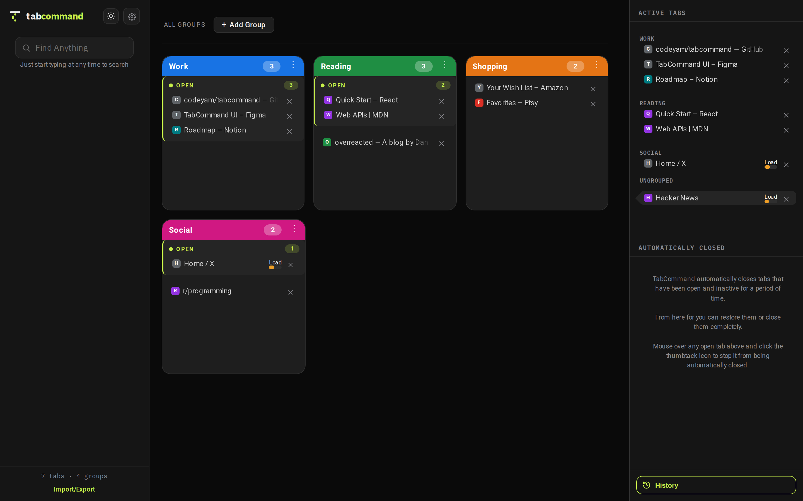
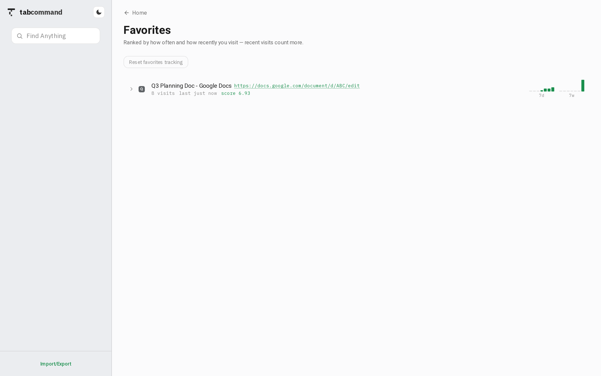
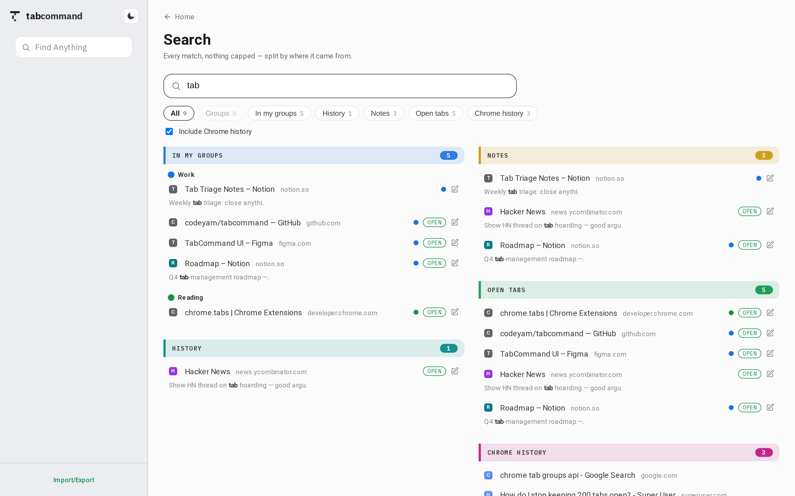
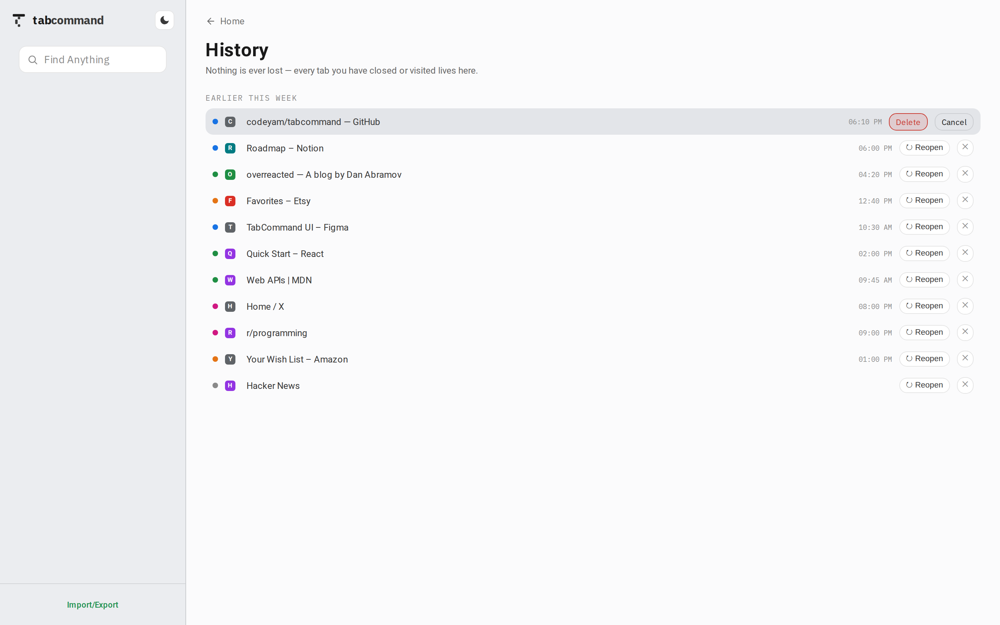
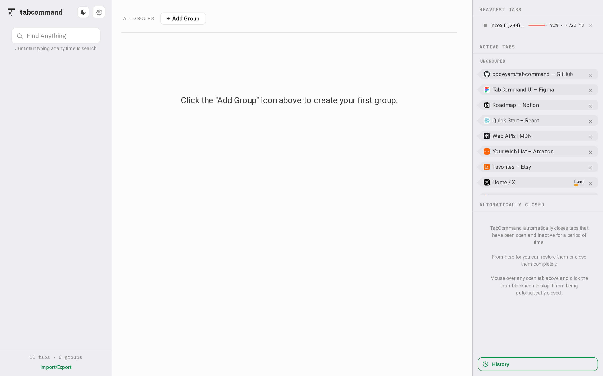
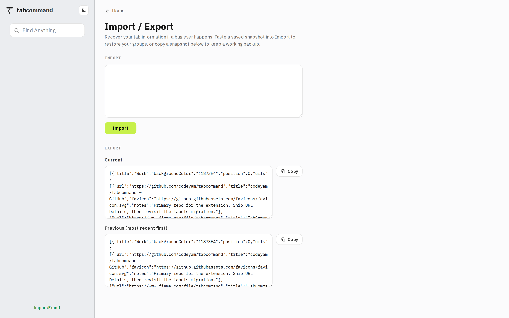
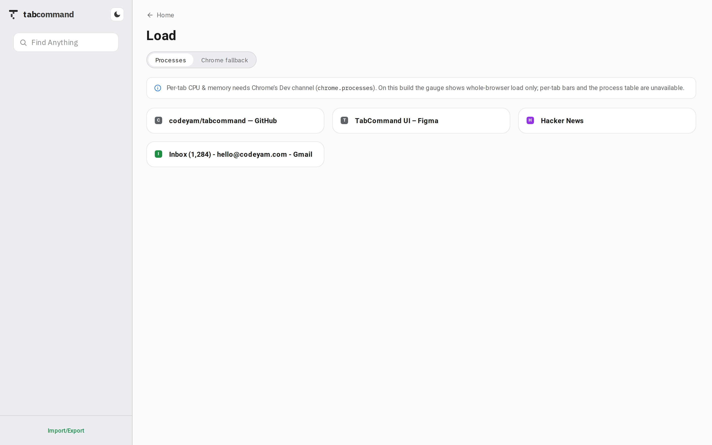
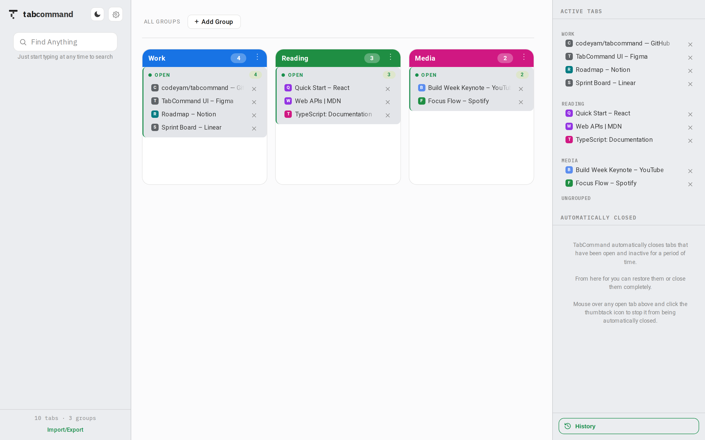

# TabCommand

[](https://codespaces.new/codeyam-ai/tabcommand?quickstart=1)

[](https://github.com/codeyam-ai/tabcommand/actions/workflows/ci.yml)
[](./LICENSE)

**Complete Tab, Bookmark, and History Control**

TabCommand is a chrome extension designed to provide complete control over your tabs, bookmarks, and history. It features favorites, grouping, and auto-close settings.

<p align="center">
  
  
</p>


## Install TabCommand

TabCommand is available for free in the Chrome Extension store.

[TabCommand Chrome Extensions](https://chromewebstore.google.com/detail/tabcommand/admgekbonebggnabmhcihnmddeeipnlg)


<!-- codeyam:run-and-edit:start d=b7f93c2a1f00 -->
## Develop this project with codeyam-editor

This project is built with [codeyam-editor](https://codeyam.com) — code and runnable data scenarios are authored side by side against a live preview.

```bash
# Clone the repo
git clone https://github.com/codeyam-ai/tabcommand && cd tabcommand

# Install codeyam-editor
npm install -g @codeyam-editor/codeyam-editor@latest

# Launch the editor (split-screen terminal + live preview)
codeyam-editor start
```
<!-- codeyam:run-and-edit:end -->

**Install and Run TabCommand Locally**

```bash
# If the tabcommand repo is not already installed
git clone https://github.com/codeyam-ai/tabcommand && cd tabcommand

# Install dependencies (pins the npm version, then installs)
npm run setup

# Build tabcommand for installation as a chrome extension
npm run build
```

Then open `chrome://extensions` → enable **Developer mode** → **Load unpacked** →
select the **`dist/extension/`** folder.

> Load `dist/extension/`, not `build/`. `build/` is a scratch directory that is
> deleted and recreated on every build — and if Chrome reads it while it is
> missing, it treats the extension as uninstalled and **destroys its stored
> data with it**. `dist/extension/` is created once and never removed wholesale,
> so it is always safe to have loaded.

After making changes to the code you must re-run `npm run build` and reload the extension from the chrome extensions manager to pick up changes.

### Upgrading from an earlier build

This version pins the extension's ID to TabCommand's published identity and
moves your groups into Chrome's synced storage, so they survive an uninstall and
follow your Google account. Two one-time consequences:

- **Export your groups before you load the rebuilt extension.** Pinning the ID
  changes the unpacked build's ID one final time, which gives it a fresh storage
  partition. Open TabCommand → **Import/Export**, copy the Current snapshot, load
  the new build, then paste it back into Import. If the snapshot passes through
  something that hard-wraps long lines on the way — an email, a chat, a note —
  Import repairs it and tells you what it fixed rather than failing silently.
- **The unpacked build and a Web Store install can no longer both be loaded.**
  They now share one identity, and Chrome refuses the second. Remove one before
  adding the other.


<!-- codeyam:scenario-gallery:start d=43db12aeab14 -->
## Scenario gallery

States captured as runnable scenarios with codeyam-editor:

### Favorites - Google Doc Survives Search Exclusion



### FullSearch - Chrome History Included



The opt-in Chrome history section switched on, with the permission already granted: the toggle is checked, its permission warning is gone, and a seventh Chrome history chip has appeared alongside the rest. The seeded browser history holds five entries matching 'tab', two of which are URLs TabCommand already tracks - those are deduped away rather than listed twice, because the tracked record carries the group, the notes and the open-tab state a raw history entry has none of. The three that remain are pages the user visited but never saved, which is exactly the gap this feature closes.

### History - Delete Confirm Armed



The delete action armed on a real History row, in full page context. Deleting a page takes a deliberate second click: the row's Reopen and delete controls give way to a red Delete beside Cancel, and the row stays visually held while the choice is pending. This is the key interaction of the History view and, unlike a native confirm dialog, a state that can actually be shown and escaped.

### Home - All Groups Deleted Tabs Survive



The boundary case: every group deleted at once. The grid falls back to its Add Group empty state and the footer reads 0 groups — but all eleven tabs are still open and still listed, now under Ungrouped. Deleting groups removes groups, never tabs. Distinct from Home - Empty, which is a profile with no tabs either; this is the populated browser a user is left with the moment after clearing their last group. It is also the state the worker's deletion diff has to survive: removing the final label drops the `labels` key wholesale rather than writing an empty map, so `newValue` arrives undefined and deletedLabelTitles has to coerce it or the deletion goes unreported.

### Import / Export - Backup



The healthy baseline of the recover/backup page: groups resolved from chrome.storage.sync and previous snapshots from local, read across both areas in one call. It seeds no syncStatus, so it is also the state where SyncWarning renders NOTHING — the third and most common of its three states, and the reason there is no isolated component scenario for it. A blank capture would prove nothing about a component whose blank state is correct; here the absence of the banner is observable against the rest of the page.

### Labels - Populated


### Load - Stable Chrome Fallback



### Load Meter - High


<!-- codeyam:scenario-gallery:end -->

## License

[MIT](./LICENSE) © 2026 NodLabs Inc.
